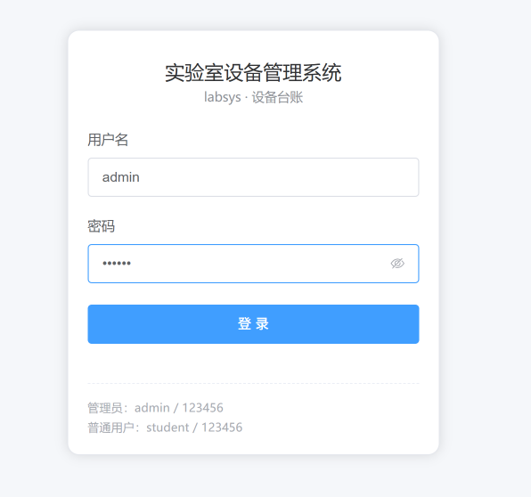
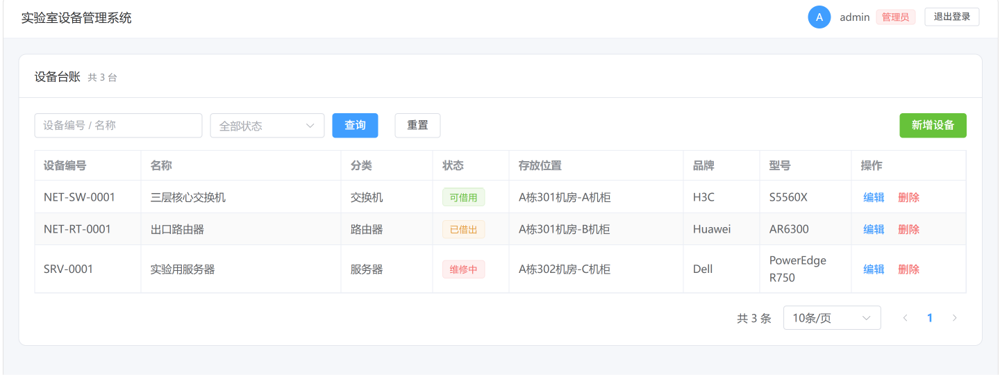

# labsys · 实验室设备管理系统

面向高校实验室的设备台账管理系统，支持登录鉴权、设备增删改查、分页检索和角色权限控制。

后端 Spring Boot + MyBatis-Plus，前端 Vue 3 + Element Plus，前后端分离。

## 界面

登录页



设备台账（管理员视角）



## 功能

- **登录鉴权**：BCrypt 校验密码，登录成功签发 2 天有效期的 Token，刷新页面不掉线
- **设备台账**：分页列表，可按「编号 / 名称」关键字和状态筛选
- **设备维护**：新增、修改、删除（删除有二次确认）
- **权限控制**：管理员可增删改，普通用户只能查看

## 技术栈

- 后端：Java 17、Spring Boot 4.1.1、MyBatis-Plus 3.5.17、MySQL 8.0
- 前端：Vue 3.5、Vite 8、Element Plus 2.14

## 快速开始

需要 JDK 17、MySQL 8、Node.js 18+。

```bash
# 1. 初始化数据库（建库建表 + 演示账号 + 示例设备）
mysql -u root -p < db/init.sql

# 2. 启动后端：先复制配置模板，把 password 改成你自己的 MySQL 密码
cd labsys-backend/labsys-backend
cp src/main/resources/application.properties.example src/main/resources/application.properties
./mvnw spring-boot:run          # Windows 用 mvnw.cmd spring-boot:run

# 3. 启动前端
cd labsys-frontend
npm install
npm run dev
```

浏览器打开 <http://localhost:5173>（Vite 8 只监听 IPv6，用 `127.0.0.1` 可能连不上）。

| 账号 | 密码 | 角色 |
| --- | --- | --- |
| `admin` | `123456` | 管理员，可增删改 |
| `student` | `123456` | 普通用户，只读 |

## 目录结构

```
labsys/
├── db/init.sql                  # 建库建表 + 初始账号 + 示例数据
├── docs/images/                 # README 用的界面截图
├── labsys-backend/              # Spring Boot 后端
│   └── labsys-backend/src/main/java/com/labsys/
│       ├── controller/          # 接口层
│       ├── interceptor/         # 登录校验、管理员校验
│       ├── mapper/ entity/ dto/ # 数据访问 / 实体 / 出入参
│       └── common/ config/      # 统一返回体、全局异常、配置
└── labsys-frontend/             # Vue 3 前端
    └── src/
        ├── App.vue              # 登录页 + 顶栏
        └── components/DeviceList.vue   # 设备台账页
```

## 待办

- [ ] 用户管理：注册、停用、改角色（完整 RBAC）
- [ ] 设备借用 / 归还，含并发冲突处理
- [ ] 维修工单与看板
- [ ] 前端路由化 + Element Plus 按需引入
- [ ] Nginx 部署上线
