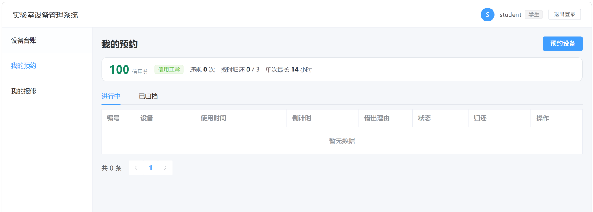
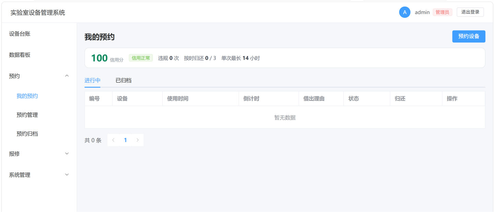

# labsys · 实验室设备管理系统

面向高校实验室的设备预约与报修系统。三种角色：学生预约设备、实验员管台账和处理工单、管理员管权限。
预约做了时段冲突检测与并发控制，超时未还会记违规并限制后续预约。

## 技术栈

后端 Java 17 + Spring Boot 4.1 + MyBatis-Plus + MySQL 8，前端 Vue 3 + Vite + Element Plus + ECharts。

## 功能

- **设备台账** —— 分页筛选，管理员可增删改、可导入导出 Excel，学生只读；实验员和管理员能点开单台设备看它的借用与报修历史
- **预约借用** —— 按时段预约，同一设备的时段不允许重叠；审批 → 借出 → 两步归还，可续借；超时未还由定时任务释放设备
- **超时处罚** —— 超时 30 分钟记 1 次违规：1 次警告、2-3 次禁约 24 小时、4 次封禁需管理员解禁；按时归还满 3 次抵 1 次
- **报修工单** —— 报修 → 受理 → 解决/驳回，全程留处理流水；受理即把设备置为维修中，解决后恢复在库；超 24 小时未受理自动催办
- **数据看板** —— 设备状态分布、借用排行、故障 TOP、7 天工单趋势，时间范围可切（7 / 30 / 90 天）
- **权限** —— 用户 → 角色 → 菜单三级，前端按菜单树动态注册路由，后端接口级拦截；停用账号或改密码会立刻作废旧令牌；个人信息、头像、改密码都在右上角头像菜单里自助维护

## 快速开始

需要 JDK 17、MySQL 8、Node.js 18+。

```bash
# 建库建表 + 演示数据（脚本可重复执行）
mysql -u root -p < db/init.sql

# 后端：复制配置模板，把 password 改成自己的 MySQL 密码
cd labsys-backend/labsys-backend
cp src/main/resources/application.properties.example src/main/resources/application.properties
./mvnw spring-boot:run

# 前端
cd labsys-frontend && npm install && npm run dev
```

浏览器打开 <http://localhost:5173>（Vite 只监听 IPv6，用 127.0.0.1 可能连不上）。

| 账号 | 密码 | 角色 |
| --- | --- | --- |
| `admin` | `123456` | 系统管理员 |
| `keeper` | `123456` | 实验员 |
| `student` | `123456` | 学生 |

Redis 只在 `labsys.lock-mode=redis` 时需要，默认 `db` 模式不依赖。

## 并发

同一台设备、同一时段，200 个请求 50 并发，超借 0 条。
默认走数据库行锁 `SELECT ... FOR UPDATE`，配 `labsys.lock-mode=redis` 可切 Redis 锁对比。

## 目录

`db/` 建库脚本 · `labsys-backend/` 后端 · `labsys-frontend/` 前端 · `docs/images/` 截图

## 界面

我的预约 —— 顶部是信用分与处罚状态，「进行中 / 已归档」分开



管理员与实验员按业务域分组，同一个「预约」下放三个页面



## 待办

- [ ] Nginx 反向代理 + 部署
